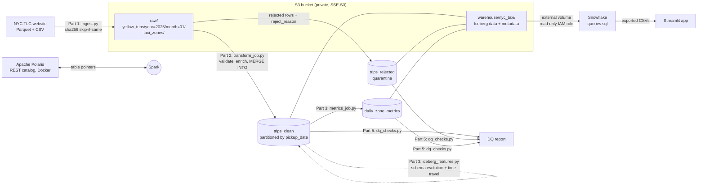

# NYC Taxi Lakehouse: S3 → Spark → Apache Iceberg (Polaris) → Snowflake

A small cloud data pipeline for a city analytics team that wants to understand **taxi demand and revenue by neighborhood**.
It lands one month of NYC TLC Yellow Taxi data in S3, cleans and enriches it with PySpark into **Apache Iceberg** tables
registered in **Apache Polaris**, and queries the results from **Snowflake**.

| | |
|---|---|
| Data | NYC TLC Yellow Taxi trips, **January 2025** (Parquet) + Taxi Zone Lookup (CSV) |
| Compute | PySpark 3.5 (local) with Iceberg 1.9 |
| Storage | Amazon S3 (private, encrypted bucket) |
| Catalog | Apache Polaris (Iceberg REST) in Docker. AWS Glue Data Catalog supported as fallback (`CATALOG_TYPE=glue`) |
| Query | Snowflake (Iceberg tables via external volume + object-store catalog integration) |
| Results URL | `<your Streamlit Community Cloud URL>` |

---

## Architecture



**Three layers**

| Layer | Where | What |
|---|---|---|
| Raw | `s3://<bucket>/raw/...` | Files exactly as downloaded (never modified) |
| Clean | Iceberg `nyc_taxi.trips_clean` | Validated, de-duplicated, enriched trips. Rejected rows go to `nyc_taxi.trips_rejected` with a `reject_reason` |
| Metrics | Iceberg `nyc_taxi.daily_zone_metrics` | trips, total revenue, avg tip %, avg trip minutes by pickup date × pickup zone |

**Why Snowflake reads through an object-store catalog integration:** Polaris runs on my laptop, so Snowflake's cloud
service can't call it. Every Iceberg commit writes a `metadata.json` to S3 anyway, so Snowflake reads that file directly
through a read-only external volume. `make snowflake-sql` prints the current metadata paths. With Snowflake Open Catalog
(hosted Polaris) or Glue you would use the catalog integration in the "Alternatives" section of `sql/snowflake_setup.sql` instead.

---

## Repository layout

```
├── src/pipeline/
│   ├── config.py              # all settings from env vars (.env), S3 keys, table names
│   ├── spark_session.py       # SparkSession wired to Iceberg + S3 + Polaris/Glue
│   ├── transforms.py          # pure, unit-tested transformation functions
│   ├── ingest.py              # Part 1
│   ├── transform_job.py       # Part 2, Part 3.1 (MERGE), Part 5 quarantine
│   ├── iceberg_features.py    # Part 3.2 schema evolution, 3.3 time travel
│   ├── metrics_job.py         # Part 3.4
│   ├── dq_checks.py           # Part 5 data quality checks
│   └── snowflake_metadata.py  # Part 4 helper: generates CREATE/REFRESH SQL
├── sql/
│   ├── snowflake_setup.sql    # external volume, catalog integration, tables
│   └── queries.sql            # the 3 analytics questions
├── tests/                     # pytest unit tests (no AWS needed)
├── infra/                     # setup/teardown scripts + least-privilege IAM policies
├── scripts/polaris_bootstrap.sh
├── docker-compose.yml         # Apache Polaris
├── app/streamlit_app.py       # results viewer (pre-exported CSVs, no credentials)
├── results/                   # query results CSVs, screenshots, DQ + time-travel reports
└── docs/RUNBOOK.md            # detailed step-by-step setup guide
```

---

## Setup

Prerequisites: Python 3.11, Java 17, Docker, AWS CLI v2, `make`, an AWS account with an **IAM admin user/SSO role (not root)**,
a Snowflake free trial on **AWS in the same region as the bucket**. Full walkthrough: [docs/RUNBOOK.md](docs/RUNBOOK.md).

```bash
python3.11 -m venv .venv && source .venv/bin/activate
make install
cp .env.example .env                       # fill in bucket name, region, Polaris secret
make aws-setup ADMIN_PROFILE=my-admin      # bucket + IAM users/roles (least privilege)
# create access keys for taxi-pipeline-user (-> AWS profile "taxi-pipeline")
# and taxi-polaris-service-user (-> POLARIS_AWS_* in .env)   see RUNBOOK step 3
make polaris-up && make polaris-bootstrap
```

## How to run each part

| Part | Command | What you should see |
|---|---|---|
| 1. Ingest to S3 | `make ingest` | `UPLOAD s3://…/raw/…` first time, `SKIP … same sha256` on re-run |
| 2. Spark → Iceberg | `make transform` | `raw=… clean=… rejected=… (raw == clean + rejected: True)` |
| 3.1 Idempotent load | `make transform` again | `trips_clean now has N rows`, same N as before |
| 3.2 + 3.3 Schema evolution, time travel | `make features` | `results/iceberg_features_report.txt` |
| 3.4 Metrics table | `make metrics` | top 10 rows of `daily_zone_metrics` |
| 4. Snowflake | `make snowflake-sql`, then run `sql/snowflake_setup.sql` + `sql/queries.sql` in Snowsight | CSVs in `results/` |
| 5. Data quality | `make dq` and `make test` | PASS/FAIL table + `results/dq_report.json`, pytest green |
| Everything | `make all` | |

---

## How each requirement is met

**Part 1 – Ingest.** `ingest.py` downloads both files and uploads them to deterministic keys
(`raw/yellow_trips/year=2025/month=01/yellow_tripdata_2025-01.parquet`, `raw/taxi_zones/taxi_zone_lookup.csv`).
Re-runs are safe: the same key is overwritten, never duplicated, and the upload is skipped when the stored SHA-256 matches.
Runs as `taxi-pipeline-user`, whose policy only allows `raw/*` and `warehouse/*` in one bucket (`infra/policies/`).

**Part 2 – Transform.**
* *Clean* — each row gets the first failing rule as `reject_reason`: `null_pickup_or_dropoff`, `dropoff_before_pickup`,
  `fare_not_positive`, `pickup_outside_month`, `duplicate` (exact duplicates: first copy kept).
* *Enrich* — `trip_minutes`, `avg_mph`, `tip_pct`, `pickup_date`, and pickup/dropoff borough + zone from the lookup (broadcast left join).
* *Write* — Iceberg v2 table `trips_clean`, partitioned by `pickup_date`.
* *Catalog* — registered in Polaris (`taxi_catalog.nyc_taxi`); Glue with `CATALOG_TYPE=glue`.

**Part 3 – Iceberg features.**
1. `MERGE INTO … ON trip_id … WHEN NOT MATCHED THEN INSERT *`. `trip_id` = SHA-256 of all original columns, a deterministic key.
2. `ALTER TABLE … ADD COLUMNS (is_airport_trip boolean)`. The report shows the data file list and snapshot count are unchanged
   (metadata-only change). Future loads fill the column automatically (`align_to_table`).
3. A backfill `UPDATE` creates a new snapshot; the report queries `VERSION AS OF <snapshot before>` vs the current snapshot and lists row counts for every snapshot.
4. `daily_zone_metrics` rebuilt with `overwritePartitions()`, so it's idempotent too.

**Part 4 – Snowflake.** Read-only external volume on `s3://<bucket>/warehouse/` + `OBJECT_STORE` catalog integration.
`sql/queries.sql` answers the three questions; results are in `results/`.

**Part 5 – Data quality.** `dq_checks.py` runs 13 checks (9 error-level, 4 warn-level): non-null keys, unique `trip_id`, fare > 0,
dropoff ≥ pickup, pickup within month, valid reject reasons, **raw = clean + rejected**, metrics vs clean trips and revenue,
zone coverage, speed / duration / negative-amount plausibility. Rejected rows are in the `trips_rejected` quarantine table.
`tests/` has 24 pytest unit tests for every transformation rule and the ingest idempotency.

---

## Results

| Question | File |
|---|---|
| Top 10 pickup zones by revenue | `results/q1_top10_revenue_zones.csv` |
| Demand by hour of day | `results/q2_demand_by_hour.csv` |
| Avg tip % by payment type | `results/q3_tip_pct_by_payment_type.csv` |
| Data quality report | `results/dq_report.json` |
| Schema evolution / time travel | `results/iceberg_features_report.txt` |

<!-- Add 2–3 bullet-point findings here after you run the queries, e.g. busiest hour, top zone, card vs cash tips. -->

---

## Assumptions

* **Month:** January 2025. "Outside the chosen month" is judged on the **pickup** date; a trip that starts 31 Jan 23:50 and ends 1 Feb is kept.
* **Revenue** = `SUM(total_amount)` (everything the passenger paid: fare, surcharges, tolls, tip).
* **tip_pct** = `tip_amount / fare_amount × 100`. Cash tips are generally not recorded by TLC, so cash trips show ~0%.
* **Exact duplicate** = every original column identical. The first copy is kept; extra copies go to quarantine as `duplicate`.
* A missing `fare_amount` is treated like a non-positive fare.
* A trip with dropoff == pickup is kept (`trip_minutes = 0`); its `avg_mph` is NULL to avoid dividing by zero.
* When a row breaks several rules, it's tagged with the **first** one, in the order listed above, so each rejected row is counted once.
* Timestamps are NYC local wall-clock time and are stored as Iceberg `timestamp` (without time zone).
* Unknown zone IDs are kept (zone names NULL) rather than dropped; coverage is monitored by a DQ check.
* `is_airport_trip` = pickup or dropoff zone is Newark (1), JFK (132) or LaGuardia (138).
* Outliers that the brief did not ask to remove (e.g. > 100 mph) are kept and reported by warn-level checks, not deleted.

## Known limitations / what I'd do next

* **Local Polaris uses in-memory persistence**: restarting the container loses the catalog (data in S3 is safe).
  Re-run `make polaris-bootstrap` and the jobs. In production: Polaris with a Postgres metastore, or Snowflake Open Catalog.
* **Snowflake refresh is manual** (`ALTER ICEBERG TABLE … REFRESH`). With Open Catalog or Glue, `AUTO_REFRESH = TRUE` removes this step.
* **MERGE is insert-only**, so a re-run never changes existing rows. If the cleaning logic changes, existing rows need a full
  refresh (drop/recreate the table, or add `WHEN MATCHED THEN UPDATE SET *`).
* Spark runs locally on one machine. Fine for one month (~3.5M rows). For many months: AWS Glue / EMR, and an orchestrator (Airflow, Step Functions).
* No table maintenance yet (`rewrite_data_files`, `expire_snapshots`, `remove_orphan_files`).
* The quarantine table mirrors the raw schema; a future TLC schema change would need a schema update there too.

## Security

* No credentials in the repo: everything comes from `.env` (git-ignored) and AWS profiles.
* Bucket: all public access blocked, default SSE-S3 encryption.
* Least privilege: the pipeline user can only touch `raw/*` and `warehouse/*` of one bucket; Polaris's user can only assume its
  storage role; Snowflake's role is read-only on `warehouse/*` and requires an external ID.
* Clean-up after review: `make aws-teardown ADMIN_PROFILE=my-admin` plus the Snowflake `DROP` statements it prints.
