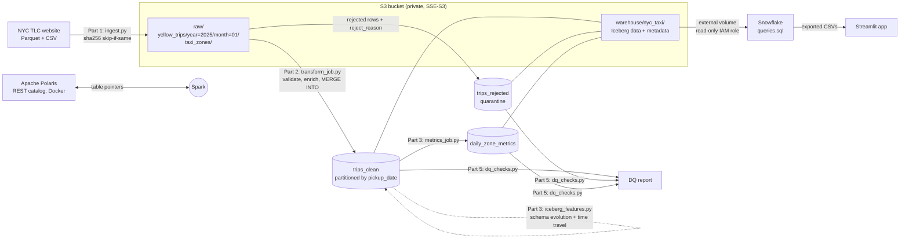

# NYC Taxi Lakehouse: S3 → Spark → Apache Iceberg (Polaris) → Snowflake

A small cloud data pipeline for a city analytics team that wants to understand **taxi demand and revenue by neighborhood**.
It lands one month of NYC TLC Yellow Taxi data in S3, cleans and enriches it with PySpark into **Apache Iceberg** tables
registered in **Apache Polaris**, and queries the same files from **Snowflake** without copying them.

| | |
|---|---|
| **Live results app** | **https://harsha-nyc-taxi-iceberg.streamlit.app/** |
| Data | NYC TLC Yellow Taxi trips, **January 2025** (Parquet, 3,475,226 rows) + Taxi Zone Lookup (CSV) |
| Compute | PySpark 3.5.7 (local, in WSL2 Ubuntu) with Apache Iceberg 1.9.2 |
| Storage | Amazon S3, private and encrypted bucket |
| Catalog | Apache Polaris (Iceberg REST catalog) in Docker. AWS Glue Data Catalog supported as a fallback (`CATALOG_TYPE=glue`) |
| Query engine | Snowflake (Iceberg tables via a read-only external volume + object-store catalog integration) |
| Tests | 24 pytest unit tests, 13 data quality checks |

---

## Results at a glance

| Table | Rows |
|---|---|
| Raw trips (January 2025) | 3,475,226 |
| `trips_clean` | **3,329,565** |
| `trips_rejected` (quarantine) | **145,661** |
| `daily_zone_metrics` | **7,261** (31 days × pickup zones) |
| Total revenue in `trips_clean` | **$90,330,278.88** |

Reconciliation: **3,475,226 raw = 3,329,565 clean + 145,661 rejected** (difference 0).

| Reject reason | Rows |
|---|---|
| `fare_not_positive` | 145,515 |
| `dropoff_before_pickup` | 124 |
| `pickup_outside_month` | 22 |
| `null_pickup_or_dropoff` | 0 |
| `duplicate` (exact duplicates) | 0 |

The null and duplicate rules are implemented and unit-tested; the January 2025 file simply contained no such rows.

### Findings for the analytics team

1. **Airports dominate revenue.** JFK Airport earns **$11.05M** (137,446 trips, **$80.42/trip**) and LaGuardia **$6.69M**
   ($76.61/trip). The other eight top-10 zones are all in Manhattan at **$20–27/trip**, even though several of them have more trips.
2. **Demand peaks at 6 PM.** About **255,000 trips** start in the 18:00 hour across the month. The quietest hour is **4 AM**
   (18,516 trips, ~600/day). Demand rises steeply from 7 AM and stays high through the evening.
3. **Early-morning trips earn the most per trip** ($31–35 at 4–5 AM, versus ~$25 midday), which fits airport runs.
4. **Card riders tip ~27%; cash shows 0%.** Credit cards are 73% of trips, with a 26.8% average tip and 94% of riders tipping.
   Cash tips are not recorded by the TLC, so cash trips show 0%. That is a property of the data, not of the riders.

### Data quality observations
* **846 trips over 100 mph** and **18 trips longer than 24 hours** (meter left running or bad GPS distance). They passed the
  brief's cleaning rules, so they are reported by warn-level checks rather than removed.
* **LaGuardia on 2025-01-20**: $1.13M from 4,224 trips (~$268/trip versus ~$77 normally). A few trips with extreme
  `total_amount` values inflate that day. In production I would add a quarantine rule for implausible amounts.

---

## Architecture



**Three layers**

| Layer | Where | What |
|---|---|---|
| Raw | `s3://<bucket>/raw/...` | Files exactly as downloaded, never modified (SHA-256 stored on each object) |
| Clean | Iceberg `nyc_taxi.trips_clean` | Validated, de-duplicated, enriched trips. Rejected rows go to `nyc_taxi.trips_rejected` with a `reject_reason` |
| Metrics | Iceberg `nyc_taxi.daily_zone_metrics` | trips, total revenue, average tip %, average trip minutes by pickup date × pickup zone |

**How Snowflake reads the tables.** Polaris runs on my laptop, so Snowflake's cloud service cannot call it. Every Iceberg commit
writes a `metadata.json` to S3 anyway, so Snowflake reads that file directly through a **read-only external volume**.
Snowflake holds no AWS keys: it assumes `taxi-snowflake-read-role`, whose trust policy only allows Snowflake's IAM user
with a fixed external ID. `make snowflake-sql` prints the current metadata paths.

---

## Repository layout

```
├── src/pipeline/
│   ├── config.py              # settings from env vars (.env), S3 keys, table names
│   ├── spark_session.py       # SparkSession wired to Iceberg + S3 + Polaris/Glue
│   ├── transforms.py          # pure, unit-tested transformation functions
│   ├── ingest.py              # Part 1
│   ├── transform_job.py       # Part 2, Part 3.1 (MERGE), quarantine table
│   ├── iceberg_features.py    # Part 3.2 schema evolution, 3.3 time travel
│   ├── metrics_job.py         # Part 3.4
│   ├── dq_checks.py           # Part 5 data quality checks
│   └── snowflake_metadata.py  # Part 4 helper: generates CREATE/REFRESH SQL
├── sql/
│   ├── snowflake_setup.sql    # warehouse, external volume, catalog integration
│   └── queries.sql            # the 3 analytics questions (fully qualified names)
├── tests/                     # 24 pytest unit tests (no AWS needed)
├── infra/                     # setup/teardown scripts + least-privilege IAM policies
├── scripts/
│   ├── polaris_bootstrap.sh   # creates the Polaris catalog
│   └── register_tables.py     # re-registers tables after a Polaris restart
├── docker-compose.yml         # Apache Polaris
├── app/streamlit_app.py       # results viewer (pre-exported CSVs, no credentials)
├── results/                   # query CSVs, screenshots, DQ + time-travel reports, logs
└── docs/                      # RUNBOOK.md (step by step), INTERVIEW_PREP.md
```

---

## Setup

Prerequisites: Python 3.11, Java 17, Docker Desktop, AWS CLI v2, `make`, an AWS account with an IAM admin user (not root),
and a Snowflake trial on **AWS in the same region as the bucket** (`us-east-1`). On Windows, everything runs inside WSL2 Ubuntu.
Full walkthrough: [docs/RUNBOOK.md](docs/RUNBOOK.md).

```bash
python3.11 -m venv .venv && source .venv/bin/activate
make install
cp .env.example .env                       # bucket name, region, Polaris password
set -a; source .env; set +a
make aws-setup ADMIN_PROFILE=my-admin      # private bucket + least-privilege IAM users/roles
# create access keys: taxi-pipeline-user -> AWS profile "taxi-pipeline",
#                     taxi-polaris-service-user -> POLARIS_AWS_* in .env   (RUNBOOK step 3)
make polaris-up && make polaris-bootstrap
```

**Machines with 8 GB RAM.** Cap WSL at 5 GB (`.wslconfig`: `memory=5GB`, `swap=8GB`) and run Spark lighter:
set `SPARK_MASTER=local[2]` and `SPARK_DRIVER_MEMORY=2g` in `.env`. The transform job persists its working data to disk
(`StorageLevel.DISK_ONLY`) so it fits in that memory.

## How to run each part

| Part | Command | What you see |
|---|---|---|
| 1. Ingest to S3 | `make ingest` | `UPLOAD` the first time, `SKIP … same sha256` on re-run |
| 2. Spark → Iceberg | `make transform` | `raw=3475226 clean=3329565 rejected=145661 (raw == clean + rejected: True)` |
| 3.1 Idempotent load | `make transform` again | `trips_clean now has 3329565 rows`, unchanged |
| 3.2 + 3.3 Schema evolution, time travel | `make features` | `results/iceberg_features_report.txt` |
| 3.4 Metrics table | `make metrics` | `7261 rows, 3329565 trips, $90330278.88 revenue` |
| 4. Snowflake | `make snowflake-sql`, then `sql/snowflake_setup.sql` + `sql/queries.sql` in Snowsight | CSVs + screenshots in `results/` |
| 5. Data quality | `make dq` and `make test` | PASS/FAIL table + `results/dq_report.json`; 24 tests pass |

**After a Polaris restart** (or if Spark reports `The provided token has expired`): the local Polaris keeps its catalog in
memory, but every table's state lives in S3, so the tables are re-registered with their full snapshot history:
```bash
docker compose restart polaris && sleep 40 && make polaris-bootstrap
PYTHONPATH=src python scripts/register_tables.py
```

**Snowflake access (one time):** run sections 1–2 of `sql/snowflake_setup.sql`, read `STORAGE_AWS_IAM_USER_ARN` from
`DESC EXTERNAL VOLUME`, then lock the AWS role's trust policy to it:
```bash
AWS_PROFILE=my-admin SNOWFLAKE_IAM_USER_ARN='<from DESC>' SNOWFLAKE_EXTERNAL_ID=taxi_iceberg_ext_id bash infra/setup_aws.sh
```

---

## How each requirement is met

**Part 1 – Ingest.** `ingest.py` downloads both files and uploads them to fixed keys
(`raw/yellow_trips/year=2025/month=01/yellow_tripdata_2025-01.parquet`, `raw/taxi_zones/taxi_zone_lookup.csv`).
A re-run overwrites the same key, never adds a copy, and skips the upload entirely when the stored SHA-256 matches
(evidence: `results/ingest_rerun.log`, `results/04_ingest_rerun_skip.png`). It runs as `taxi-pipeline-user`, which can only
touch `raw/*` and `warehouse/*` in one bucket and gets `AccessDenied` elsewhere (`results/01_iam_least_privilege.png`).

**Part 2 – Transform.**
* *Clean:* each row gets the first rule it fails as `reject_reason`: `null_pickup_or_dropoff`, `dropoff_before_pickup`,
  `fare_not_positive`, `pickup_outside_month`, `duplicate` (for exact duplicates the first copy is kept).
* *Enrich:* `trip_minutes`, `avg_mph`, `tip_pct`, `pickup_date`, plus pickup and dropoff borough + zone (broadcast left join on the lookup).
* *Write:* Iceberg v2 table `trips_clean`, partitioned by `pickup_date` (31 data files, one per day).
* *Catalog:* registered in Polaris as `taxi_catalog.nyc_taxi.trips_clean` (`results/02_polaris_catalog.png`).

**Part 3 – Iceberg features** (full output in `results/iceberg_features_report.txt`).
1. **MERGE INTO** on `trip_id` (SHA-256 of all original columns) with `WHEN NOT MATCHED THEN INSERT`. The second run kept
   3,329,565 rows, and the snapshot history shows its commit adding nothing.
2. **Schema evolution:** `ALTER TABLE … ADD COLUMNS (is_airport_trip boolean)`. *Data files before ALTER: 31, after: 31,
   identical: True*, and the snapshot count did not change: a metadata-only change.
3. **Time travel:** a backfill `UPDATE` created a new snapshot. `VERSION AS OF` the snapshot before it: 3,329,565 rows and no
   `is_airport_trip` column; after it: 3,329,565 rows with **281,469** airport trips. Row counts for every snapshot:
   0 (create) → 3,329,565 (load) → 3,329,565 (idempotent re-run) → 3,329,565 (backfill).
4. **Metrics:** `daily_zone_metrics` rebuilt with `overwritePartitions()`, so it is idempotent too.

**Part 4 – Snowflake.** A read-only external volume on `s3://<bucket>/warehouse/` plus an `OBJECT_STORE` catalog integration.
Row counts in Snowflake match Spark exactly (`results/snowflake_row_counts.png`). `sql/queries.sql` answers the three
questions; results are in `results/q1_…`, `q2_…`, `q3_….csv` with screenshots.

**Part 5 – Data quality.** `dq_checks.py` runs 13 checks. **All 9 error-level checks pass**: non-null keys, unique `trip_id`,
fare > 0, dropoff ≥ pickup, pickup within the month, valid reject reasons, **raw = clean + rejected**, metrics trips = clean rows,
and metrics revenue = clean revenue (to the cent). Of the 4 warn-level checks, zone coverage and non-negative amounts pass;
speed (>100 mph: 846 rows) and duration (>24 h: 18 rows) report real-world outliers. Rejected rows are in the
`trips_rejected` quarantine table. `tests/` holds 24 pytest unit tests for every transformation rule and for ingest idempotency.

---

## Evidence in `results/`

| File | Shows |
|---|---|
| `q1_top10_revenue_zones.csv`, `snowflake_q1.png` | Top 10 pickup zones by revenue |
| `q2_demand_by_hour.csv`, `snowflake_q2.png` | Trip demand by hour of day |
| `q3_tip_pct_by_payment_type.csv`, `snowflake_q3.png` | Average tip % by payment type |
| `snowflake_row_counts.png` | Snowflake reads the same row counts as Spark |
| `iceberg_features_report.txt`, `features.log` | Schema evolution + time travel |
| `dq_report.json`, `dq.log` | Data quality results |
| `ingest_rerun.log`, `metrics.log` | Idempotent ingest, metrics build |
| `01`–`05_*.png` | Least privilege, Polaris catalog, Polaris in Docker, ingest SKIP, metrics build |
| `streamlit_app_top10.png`, `streamlit_app_hourly.png` | The deployed app (backup if the free app is asleep) |

---

## Assumptions

* **Month:** January 2025. "Outside the chosen month" is judged on the **pickup** date; a trip that starts on 31 Jan and ends on 1 Feb is kept.
* **Revenue** = `SUM(total_amount)`: everything the passenger paid (fare, surcharges, tolls, tip).
* **tip_pct** = `tip_amount / fare_amount × 100`. Cash tips are generally not recorded by the TLC.
* **Exact duplicate** = every original column identical. The first copy is kept; extra copies go to quarantine as `duplicate`.
* A missing `fare_amount` is treated like a non-positive fare.
* A trip with dropoff == pickup is kept (`trip_minutes = 0`), and its `avg_mph` is NULL to avoid dividing by zero.
* A row breaking several rules is tagged with the **first** one, so each rejected row is counted once and raw = clean + rejected holds.
* Timestamps are NYC local time and are stored as Iceberg `timestamp` (without time zone).
* Unknown zone IDs are kept with NULL zone names rather than dropped (none occurred in January 2025).
* `is_airport_trip` = pickup or dropoff zone is Newark (1), JFK (132) or LaGuardia (138).
* Outliers the brief did not ask to remove (e.g. > 100 mph) are kept and reported by warn-level checks.
* The schema change itself (ALTER) rewrites no data. The optional backfill `UPDATE` is a separate step used as the "change" for time travel.

## Known limitations / what I'd do next

* **Local Polaris keeps its catalog in memory** and caches AWS credentials for about an hour. After a restart or a long pause,
  tables are re-registered from S3 with `scripts/register_tables.py`. In production: Polaris with a Postgres metastore, or Snowflake Open Catalog.
* **Snowflake refresh is manual** (`ALTER ICEBERG TABLE … REFRESH`). With Open Catalog or Glue, `AUTO_REFRESH = TRUE` removes this step.
* **MERGE is insert-only**, so a re-run never changes existing rows. If cleaning logic changes, the table needs a full reload
  (or `WHEN MATCHED THEN UPDATE SET *`).
* Spark runs locally. One month (~3.5M rows) fits in 5 GB with the disk-persist setting; for many months I would use AWS Glue or
  EMR and an orchestrator (Airflow, Step Functions).
* No table maintenance yet (`rewrite_data_files`, `expire_snapshots`, `remove_orphan_files`).
* Implausible amounts and speeds are only reported; a stricter rule set would quarantine them.

## Security

* No credentials in the repo: everything comes from `.env` (git-ignored) and AWS CLI profiles.
* Bucket: all public access blocked, default SSE-S3 encryption.
* Least privilege: the pipeline user can only touch `raw/*` and `warehouse/*` of one bucket; Polaris's user can only assume its
  storage role; Snowflake's role is read-only on `warehouse/*` and requires an external ID. Snowflake stores no AWS keys.
* The Streamlit app reads only exported CSVs, so it has no credentials at all.
* Clean-up after review: `make aws-teardown ADMIN_PROFILE=my-admin`, plus the Snowflake `DROP` statements it prints.
